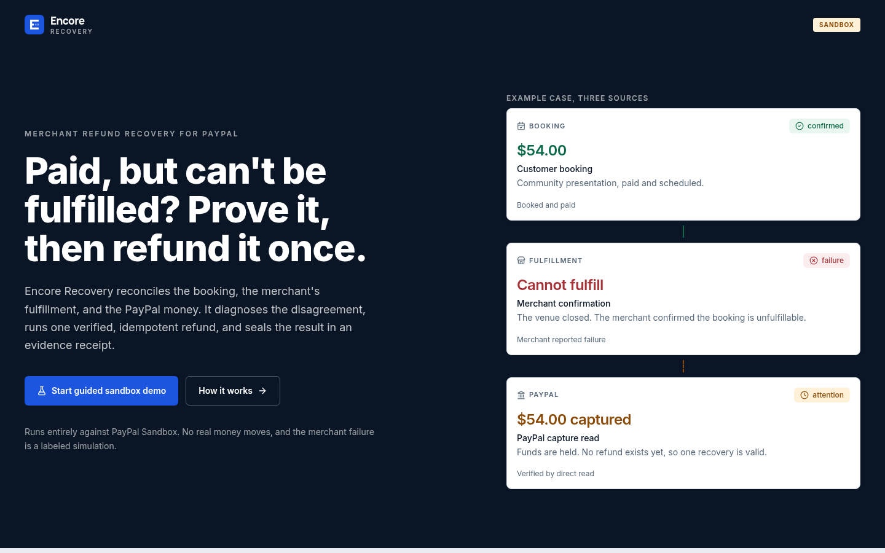
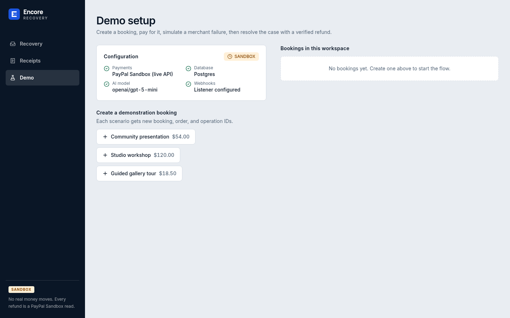
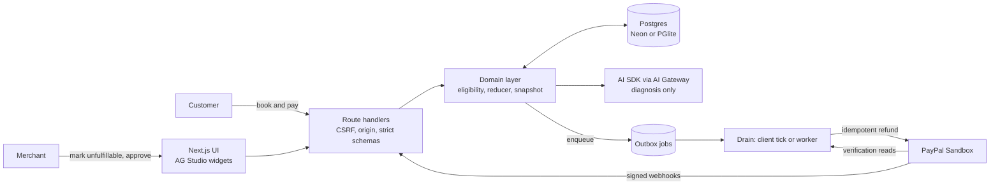

<div align="center">


# Encore Recovery

**Paid, but can't be fulfilled? Prove it, then refund it once.**

A merchant-side refund-recovery system on the PayPal Sandbox. It reconciles the booking, the merchant's fulfillment, and the PayPal money, diagnoses the disagreement with AI, and executes exactly one verified, idempotent refund behind a human approval.


</div>



## The problem

A customer pays for a booking. The merchant then cannot deliver it (venue closed, instructor sick, double booking). Now three systems disagree: the booking says _paid_, the merchant says _cannot fulfill_, and PayPal says _funds held_. Fixing that by hand is slow and risky: refund twice and the merchant loses money, refund the wrong amount and the customer is shortchanged, trust a dropped network response and nobody knows what happened.

## What Encore Recovery does

1. **Pay.** A customer books and pays through PayPal Sandbox. The capture is verified server-side with a direct read.
2. **Fail.** The merchant marks the booking unfulfillable, which opens a recovery case. (In the demo this failure is a labeled simulation.)
3. **Diagnose.** An AI model reads a server-built snapshot of the booking, policy, and payment and returns a schema-validated diagnosis. It can cite evidence. It can never set an amount, a recipient, or a URL.
4. **Plan.** Deterministic eligibility rules build the refund plan. The plan is bound to a fingerprint of the facts it was built from, so any change makes it stale.
5. **Approve and refund.** The merchant approves. A durable outbox job sends the refund with a stable `PayPal-Request-Id`.
6. **Prove.** Provider responses and signature-verified webhooks are reduced to a final state, and an immutable evidence receipt is sealed.

| Landing | Guided demo |
| --- | --- |
|  |  |

## Design principles

- **The model advises, rules decide, humans approve.** AI output is advisory and structurally unable to move money.
- **Money state comes from PayPal, not from us.** Completion requires a verified `COMPLETED` read whose amount, currency, and invoice match the operation.
- **Uncertainty is a first-class state.** A lost refund response becomes `UNKNOWN`, which is visible and recoverable by same-key replay or a verified webhook. It is never silently retried with a new key.
- **Everything is replayable.** Every transition is an audit event, and receipts are immutable as-of snapshots.

See [docs/ARCHITECTURE.md](docs/ARCHITECTURE.md) for the full design and [docs/SECURITY.md](docs/SECURITY.md) for the invariants and threat model.

## Architecture at a glance



## Tech stack

| Layer | Choice |
| --- | --- |
| App | Next.js 16 (App Router), React 19, TypeScript, Tailwind CSS 4 |
| Data | Postgres on Neon, plain `pg` with ordered SQL migrations (no ORM); in-process PGlite fallback |
| Payments | PayPal Sandbox Orders and Payments APIs, verified webhooks; fixture provider fallback |
| AI | AI SDK with Vercel AI Gateway, structured output, default `openai/gpt-5-mini`, fallback `google/gemini-2.5-flash` |
| Dashboard | AG Studio custom widgets on `/recovery` |
| Jobs | Durable outbox drained by a client-driven tick, an internal endpoint, or `pnpm worker` |
| Tests | Vitest unit and integration suites (56 tests) |

## Getting started

Requires Node 20+ and pnpm.

```bash
pnpm install
pnpm dev
```

With no environment variables the app runs against in-process PGlite and a fixture PayPal provider, so it works offline with zero setup. Open:

- `/demo` to book, pay, fail the booking, and recover it end to end
- `/recovery` for the case queue and AG Studio dashboard
- `/receipts` for sealed evidence receipts

### Running against real services

```bash
cp .env.example .env.local   # fill in values
pnpm db:migrate
pnpm dev
```

Register `https://<your-domain>/api/webhooks/paypal` in your PayPal Sandbox app for refund events and put the resulting id in `PAYPAL_WEBHOOK_ID`. See [.env.example](.env.example) for every variable.

## Scripts

| Command | Purpose |
| --- | --- |
| `pnpm dev` | Start the dev server |
| `pnpm build` / `pnpm start` | Production build and server |
| `pnpm typecheck` | TypeScript, no emit |
| `pnpm db:migrate` | Apply SQL migrations |
| `pnpm worker` | Run the outbox worker as a separate process |
| `pnpm test` | All tests |
| `pnpm test:unit` | Eligibility, reducer, money, AI contract |
| `pnpm test:integration` | Payment, recovery, interruption, and security paths |

## Repository layout

```
app/                 Routes and API handlers (App Router)
  api/               bookings, recovery, receipts, webhooks, jobs, status
components/encore/   Product UI, including studio/ (AG Studio widgets)
lib/domain/          Eligibility, refund reducer, snapshots, receipts, audit
lib/paypal/          Provider interface, sandbox client, fixture provider
lib/ai/              Diagnosis adapter (AI SDK, schema validation, repair)
lib/jobs/            Outbox drain and refund job
lib/db/              Client, migration runner, seed
migrations/          Ordered SQL migrations 0001 to 0007
worker/              Standalone outbox worker entry
tests/               unit/ and integration/
docs/                Architecture, security, images
```

## Testing

The suite covers the full money path and the failure cases: dropped responses, a refund the database never recorded, replayed and out-of-order webhooks, forged signatures, CSRF and origin attacks, and tampered inputs. Integration tests run on PGlite with the fixture provider, so they need no credentials.

## Scope and honesty

Encore Recovery is a hackathon prototype. It runs only against PayPal Sandbox; no real money moves. The merchant failure in the demo is a labeled simulation, and the fixture provider exists only so the app and tests run without credentials. It supports full refunds only, one currency per case, and a single approved policy per workspace.

## Contributing

See [CONTRIBUTING.md](CONTRIBUTING.md).

## License

MIT. See [LICENSE](LICENSE).
