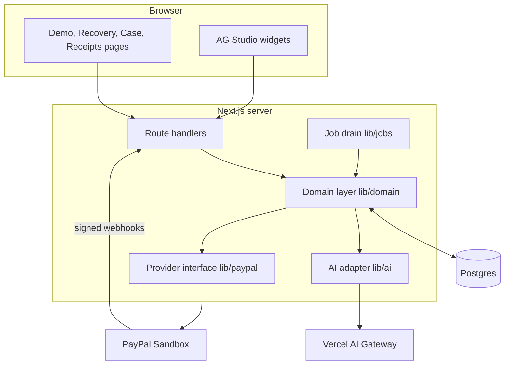
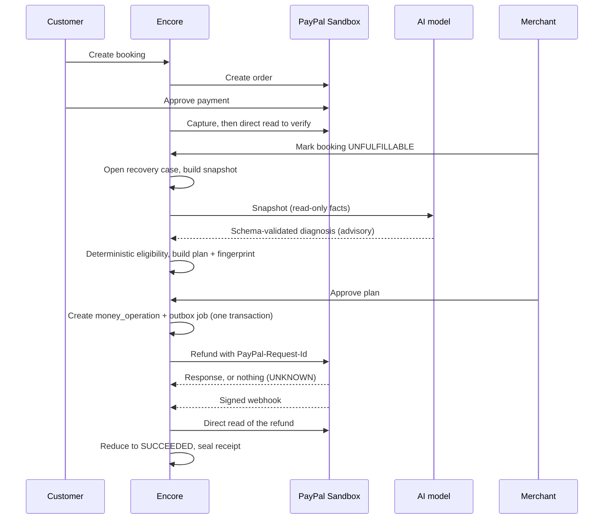
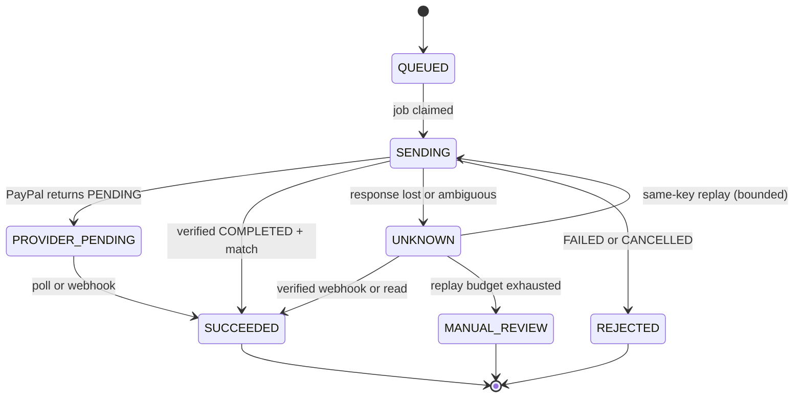

# Architecture

Encore Recovery is a single Next.js application with a Postgres database and a durable outbox. This document explains how a paid-but-unfulfillable booking becomes one verified refund.

## 1. System context

The provider interface has two implementations: `sandbox.ts` (real PayPal Sandbox) and `fake.ts` (a deterministic fixture used for local development and tests). The database is Neon Postgres when `DATABASE_URL` is set and in-process PGlite otherwise. Both run the same SQL migrations.

## 2. Domain model

Migrations `0001` to `0007` create these tables.

| Table | Role |
| --- | --- |
| `workspaces`, `sessions` | Tenant scope and cookie-backed demo sessions |
| `merchant_policies`, `booking_templates` | The approved refund policy (content-hashed) and demo scenarios |
| `bookings` | A customer booking with a fulfillment state and a monotonically increasing `revision` |
| `payment_orders` | One PayPal order per payment attempt. A partial unique index (`payment_orders_one_live_per_booking`) allows only one live order per booking |
| `captures` | Verified PayPal captures with amount, currency, status, and payee merchant id |
| `recovery_cases` | The disagreement being resolved |
| `analyses` | AI diagnoses, with the exact input snapshot and model used |
| `recovery_plans` | The deterministic refund plan, bound to a fact fingerprint |
| `money_operations` | The refund operation: the single source of truth for send attempts, state, and the request id |
| `webhook_events` | Every verified inbound event, deduplicated by provider event id |
| `outbox_jobs`, `worker_heartbeats` | Durable work queue and worker liveness |
| `fixture_provider_objects`, `armed_faults` | Fixture provider state and injectable faults for demos and tests |
| `audit_events`, `evidence_receipts` | Append-only audit trail and sealed receipts |

## 3. The recovery lifecycle

### 3.1 Snapshot and fingerprint

`lib/domain/snapshot.ts` builds the facts the AI and the rules see: booking, verified capture, policy, and any existing operation. `lib/domain/eligibility.ts` hashes the decisive subset into a fingerprint stored on the plan. If the booking revision, capture, or policy changes, the fingerprint no longer matches and the plan is `STALE` and cannot be executed.

### 3.2 Eligibility

`evaluateEligibility` is a pure function with no I/O and no model input. A refund is eligible only when the merchant confirmed the booking `UNFULFILLABLE`, a verified, non-pending capture exists, the capture payee matches the expected merchant, the policy is the approved one, and no live operation already exists. Otherwise it returns one of `NEEDS_INFORMATION`, `WAIT_FOR_PAYMENT`, `REVIEW_REQUIRED`, or `EXISTING_OPERATION` with a reason code.

### 3.3 AI boundary

`lib/ai/adapter.ts` calls the model through the AI SDK with structured output and a deliberately simple schema. The result is re-validated against a stricter server schema. Models are tried in order (`AI_MODEL`, then `AI_FALLBACK_MODELS`), and an invalid object gets exactly one repair attempt. The output has no field that can carry an amount, recipient, or URL, so a compromised or confused model cannot influence money movement.

### 3.4 Execution and the outbox

Approving a plan, in a single database transaction, creates the `money_operation`, writes the audit event, and inserts an `outbox_jobs` row. A drain step later claims the job and calls PayPal. Because the intent is durable before any network call, a crash at any point leaves a recoverable state.

Drain triggers, all idempotent and safe to run concurrently:

- the client-driven `POST /api/jobs/tick` (works on serverless with no worker)
- the protected `POST /api/internal/jobs/drain` (token via `INTERNAL_JOB_TOKEN`)
- `pnpm worker`, a standalone process that also writes heartbeats

### 3.5 Refund state machine

The transition logic lives in `lib/domain/refund-reducer.ts` as pure functions:

- `reduceRefundObservation` marks `SUCCEEDED` only if the status is `COMPLETED` and amount, currency, and `invoice_id` (`ER-<operationId>`) all match. A completed refund that does not match goes to `MANUAL_REVIEW`. Unknown provider statuses are preserved and routed to review.
- Pending refunds are polled with backoff of 5s, 15s, 60s, then 5min (`nextPollDelayMs`).
- Ambiguous writes are replayed with the **same** request id, with backoff of 2s, 5s, 15s, 30s, 60s, within a 5 minute window and at most 5 attempts (`canReplay`).

### 3.6 Webhooks

`POST /api/webhooks/paypal` verifies the signature with PayPal (`PAYPAL_WEBHOOK_ID`) before touching anything. A forged event returns an error and leaves no trace in operations, jobs, or audit tables. Verified events are stored once (deduplicated by provider event id), then reduced through the same reducer as direct reads, so a late or replayed event cannot move a completed operation backward.

### 3.7 Evidence receipts

Once an operation is `SUCCEEDED`, `lib/domain/receipts.ts` seals a receipt: the observed provider facts, timestamps, the plan fingerprint, the diagnosis summary, and the replayable event trail. Receipts are immutable as-of snapshots, and the UI can print them or step through the event replay.

## 4. API surface

| Route | Purpose |
| --- | --- |
| `POST /api/demo/session` | Create a demo workspace and session |
| `POST /api/bookings` | Create a booking |
| `POST /api/bookings/[id]/checkout` | Create the PayPal order |
| `POST /api/bookings/[id]/capture` | Capture and verify payment |
| `POST /api/bookings/[id]/cancel-payment` | Abandon a payment attempt |
| `POST /api/bookings/[id]/merchant-failure` | Mark unfulfillable, open a case |
| `GET /api/recovery/cases`, `GET /api/recovery/cases/[id]` | Queue and case detail |
| `POST /api/recovery/cases/[id]/analyze` | Run the AI diagnosis |
| `POST /api/recovery/cases/[id]/reconcile` | Re-read provider state |
| `POST /api/recovery/cases/[id]/fault` | Arm a fixture fault (demo and tests) |
| `POST /api/recovery/plans/[id]/execute` | Approve and enqueue the refund |
| `GET /api/receipts` | Sealed receipts |
| `POST /api/webhooks/paypal` | Verified PayPal webhooks |
| `POST /api/jobs/tick`, `POST /api/internal/jobs/drain` | Drain the outbox |
| `GET /api/status` | Mode, database, AI model, and webhook readiness |

## 5. Frontend

Pages: landing (`/`), guided demo (`/demo`, with the fixture approval and PayPal return screens), recovery queue (`/recovery`), case workspace (`/case/[id]`), and receipts (`/receipts`). The recovery page hosts AG Studio custom widgets (`components/encore/studio/`) for the live queue, recovery preview, and evidence receipt. Widget data is derived from server projections in `lib/studio/datasets.ts`. The UI shows three source-of-truth cards (booking, fulfillment, PayPal) and a mismatch ribbon so a disagreement is visible at a glance.

## 6. Configuration

| Variable | Purpose |
| --- | --- |
| `APP_MODE` | `fixture` (default) or `sandbox` |
| `DATABASE_URL` | Postgres connection; PGlite when unset |
| `PAYPAL_CLIENT_ID`, `PAYPAL_CLIENT_SECRET`, `PAYPAL_MERCHANT_ID` | PayPal Sandbox app and expected payee |
| `PAYPAL_US_*` | Optional US Business account trio that overrides the above |
| `PAYPAL_WEBHOOK_ID` | Webhook id used for signature verification |
| `AI_MODEL`, `AI_FALLBACK_MODELS` | Gateway model ids |
| `INTERNAL_JOB_TOKEN` | Protects the internal drain endpoint |
| `DEPLOYMENT_TARGET` | `local`, `vercel`, or `render`; `fixture` mode is rejected on `render` |
| `FIXTURE_REFUND_COMPLETE_MS` | Simulated settle delay for the fixture provider |

## 7. Key decisions

- **Plain `pg` and SQL migrations, no ORM.** Money logic depends on exact transaction and locking behavior, and explicit SQL keeps that reviewable.
- **PGlite fallback.** Judges and contributors can run the whole system, including integration tests, with no credentials.
- **Outbox over inline calls.** The refund intent is committed before the network call, which is what makes crash recovery possible.
- **Client-driven drain.** Serverless platforms have no long-lived worker, so the UI ticks the queue while a case is open. A real worker (`pnpm worker`) is available for deployments that can host one.
- **Pure reducers.** Eligibility and refund reduction have no I/O, so the hardest logic is unit-tested exhaustively.
